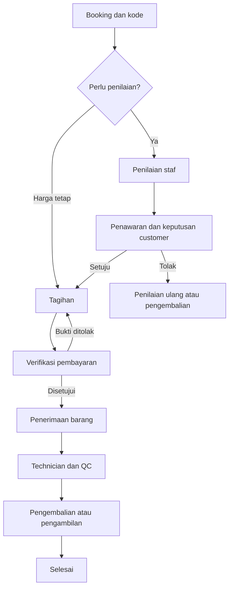

# Arsitektur dan pemetaan prototype

## Struktur aplikasi

| Bagian | Implementasi |
| --- | --- |
| UI customer | Blade dan class Livewire `PublicPage`, `Booking`, `Tracking`, `Chatbot` |
| UI staf | `StaffLogin`, `Dashboard`, `StaffOrder`, `Management` |
| Transaksi | `app/Services/Workflow.php`; semua command mengambil row lock pada order |
| Otorisasi | `OrderAccess`, `ActiveStaff`, role-permission pivot dan pengecekan ulang pada setiap command |
| Katalog/pengaturan | `Masters`; publish versi baru dan catat audit |
| Harga | `Pricing`, immutable tariff/promo/shipping versions; view `quote_totals` |
| Laporan | `Reports`, view `verified_sales`, serta ekspor CSV dan PDF sesuai akses |
| Berkas | `MediaStorage`; gambar pribadi pada disk local, route staf dengan pemeriksaan akses |
| RAG | `Knowledge` + `Assistant`; HTTP Gemini dari server, embedding JSONB dan cosine similarity |

Tidak ada Node/Worker server pendamping. Node hanya membangun aset Vite. Tidak membutuhkan Redis, pgvector atau queue worker untuk penggunaan awal. Pencarian embedding di PHP cocok untuk korpus panduan kecil; untuk ribuan dokumen, pindahkan pencarian ke pgvector beserta indeksnya.

## Data

31 tabel domain mengikuti rancangan relasional sebelumnya. Implementasi menambahkan atribut operasional seperti `remember_token`, pilihan poster, foto cabang, nama berkas, catatan penolakan, serta **2 tabel knowledge**. Laravel juga memakai tabel migrasi, session, cache dan jobs. Jumlah tabel fisik keseluruhan karena itu lebih besar dari 31.

`database/schema/puro.sql` dijalankan oleh migrasi pertama. Migrasi berikutnya menambah kebutuhan runtime, trigger riwayat, validasi pembayaran lintas order, indeks dan pemeriksaan status. Gunakan migrasi Laravel sebagai sumber pemasangan; jangan mengimpor SQL manual lalu menjalankan migrasi yang sama.

Tarif, promo, kebijakan jemput, QRIS, harga per item, verified payment, QC dan status history tidak ditimpa. Penawaran baru, upaya bukti baru dan siklus rework baru adalah baris baru. Perubahan status/keputusan melalui workflow, bukan input status bebas dari browser.

## Alur

Pemeriksaan fisik dapat terjadi sebelum pembayaran dengan consent customer. **Pengerjaan treatment tetap memerlukan pembayaran treatment terverifikasi dan bukti penerimaan barang.** Jika treatment ditolak setelah pickup, tagihan LOGISTICS hanya membuka pengembalian, tidak membuka penugasan teknisi.

## Pengganti penyimpanan prototype

| Prototype | Laravel |
| --- | --- |
| Order/staf/master di localStorage | PostgreSQL dan session server |
| Password akun demo di JavaScript | Hash password; seeder lokal opt-in |
| Data gambar base64 di browser | File acak pada storage dan metadata database |
| Perubahan status dalam satu browser | Transaksi server + polling antarperangkat |
| Gemini Worker JS | Laravel HTTP client dengan env server |
| Chat dan pesanan terakhir pada browser | Tetap bounded di browser untuk kenyamanan; bukan sumber data transaksi |

## Privasi dan batas integrasi

Kode pesanan dibuat saat booking berhasil dan digunakan di checkout, konfirmasi pembayaran, serta tracking. Hash dipakai untuk pencarian dan salinan kode dienkripsi oleh APP_KEY. Siapa pun yang mempunyai kode dapat melakukan aksi customer pada order tersebut. Tracking menampilkan ringkasan dan foto pengantaran kurir setelah status selesai. Foto pengantaran dikirim lewat route berkode pesanan dari penyimpanan privat. Bukti pembayaran dan foto treatment tersedia untuk staf sesuai akses. Respons checkout, tracking, dan staf diberi `no-store` dan referrer policy `no-referrer`.

Chatbot tidak mengakses database order. Riwayat pertanyaan terbatas dikirim ke Gemini bersama potongan panduan saat customer meminta jawaban AI. Tidak ada percakapan customer permanen di tabel database. Fallback WhatsApp berupa draf, bukan integrasi WhatsApp Business API dan bukan inbox admin internal.

Verifikasi pembayaran masih **manual**, sesuai prototype. Tidak ada gateway/payment webhook atau pembacaan otomatis mutasi bank. Alamat dan QRIS demo harus diganti untuk operasional.
